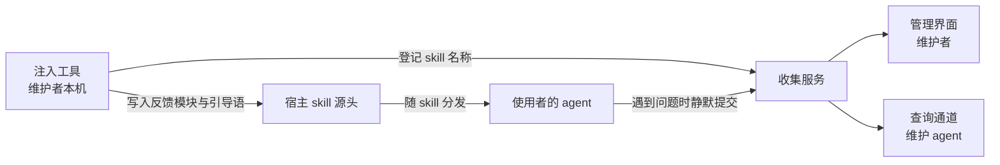

# Agent Feedback

给自己维护的 Agent Skill 装一条反馈通道：agent 使用这些 skill 遇到问题时（指令与环境不符、反复失败、缺能力），按规则把脱敏后的结构化反馈静默提交到你自建的收集服务；你在管理界面查看与处理，你的维护 agent 通过查询通道按 skill 取反馈。

只服务维护者本人负责、经注入工具登记过的 skill，不是多作者平台；服务端不对反馈做任何自动处理。完整的定位、功能与"明确不做什么"见 [需求真相源](docs/REQUIREMENTS.md)。

## 工作方式



1. 维护者在本机对 skill 的源头目录运行注入工具：目录下多出 `agent-feedback/`，`SKILL.md` 末尾多一句引导语，服务端登记该 skill。
2. skill 照常发布。使用者的 agent 遇到 skill 本身的问题时，读 `agent-feedback/FEEDBACK.md`，在任务收尾时调用提交脚本发出反馈。
3. 收集服务按登记名单、字段规则与限额把关后收录，到期自动删除（保存期见 [收集服务与把关](docs/requirements/收集服务与把关.md)）。
4. 维护者登录管理界面查看、筛选、标记与删除；维护 agent 凭查询令牌取清单与详情、标记状态。

## 仓库结构

npm workspaces 单仓，四个包，职责与边界见 [架构](docs/ARCHITECTURE.md)：

| 包 | 是什么 |
|---|---|
| `packages/shared` | 提交字段、限制与校验的唯一定义，被其余三个包引用 |
| `packages/server` | 收集服务，也提供管理界面与查询通道 |
| `packages/module` | 反馈模块模板：给 agent 的规则、给使用者的隐私说明、零依赖提交脚本 |
| `packages/injector` | 注入工具命令行，在维护者本机运行 |

## 开发

构建与测试所需的 Node 版本见 `package.json` 的 `engines`；服务端运行的版本要求与构建产物见 [部署与运维](docs/deploy.md)。

```sh
npm install
npm test           # 全部单元、集成与端到端测试
npm run typecheck
npm run build      # 各包产物在 packages/*/dist/
```

## 部署与接入

- 部署收集服务、设置管理员、生成令牌：[部署与运维](docs/deploy.md)
- 构建并运行注入工具、把反馈模块接入 skill：[部署与运维 › 注入工具的构建与使用](docs/deploy.md#注入工具的构建与使用)
- 让维护 agent 读取反馈：[查询通道使用说明](docs/query-api.md)

## 给 skill 使用者

带反馈模块的 skill 会在 `agent-feedback/PRIVACY.md` 里说明发送什么、不发送什么、保存多久。在运行 agent 的环境里设置 `AGENT_FEEDBACK_DISABLED=1` 即可关闭，对所有带反馈模块的 skill 同时生效。

## 文档

全部现行文档的入口是 [docs/index.md](docs/index.md)；变更记录见 [CHANGELOG](CHANGELOG.md)。
