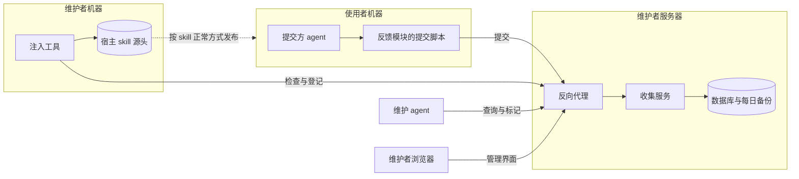

# Agent Feedback 架构与边界

> 只写模块划分、职责、边界与交互；不复述接口字段。需求见 [REQUIREMENTS](REQUIREMENTS.md)。已定技术决策与接口总表见 `docs/spec/2026-09-29-agent-feedback-overview.md`，契约（字段、接口、环境变量、命令行）见 `docs/spec/2026-09-29-agent-feedback-eng-spec.md`，实现事实与陷阱见 `engineering-context/cards/agent-feedback.md` 及其域卡。

## 系统组成

单仓（npm workspaces），四个包，另有不入 workspaces 的维护 skill：

| 目录 | 职责 | 边界（不管什么） | 运行在哪 |
|---|---|---|---|
| `packages/shared` | 提交内容的字段、长度与取值限制、校验函数、拒收码、skill 名校验的唯一定义 | 不碰网络与存储 | 被其余三个包引用，不单独部署 |
| `packages/server` | 收集服务：公开提交入口与把关、登记入口、查询通道、管理界面（服务端渲染）、令牌与登录会话、限额与拒收计数、到期清理、每日备份、健康检查；是反馈数据与登记名单的唯一权威 | 不改宿主 skill 文件，不碰使用者本机 | 维护者的服务器：单进程，单文件数据库，前面由既有反向代理终结 HTTPS，由系统服务托管（部署文件在 `packages/server/deploy`） |
| `packages/module` | 反馈模块模板：给 agent 的规则说明、给使用者的公开说明、零依赖提交脚本、忽略规则；只管何时报、报什么、怎么发 | 不判定提交是否被收录，不重试，不暂存 | 随宿主 skill 分发到使用者机器，提交脚本由 agent 调用 |
| `packages/injector` | 注入工具命令行：维护者本机的实例配置、前置检查、写反馈模块与引导语、向服务登记、失败回滚 | 不碰反馈数据，不做查询 | 维护者本机 |
| `skills/agent-feedback` | 维护 skill：教维护 agent 给 skill 源头注入反馈模块，以及在 skill 仓库里维护 skill 前先查反馈、按处理规则改进 | 不带工具链与令牌（注入复用注入工具，查询复用查询通道），不进分发包 | 维护者的各 skill 仓库（仓库层技能目录） |

宿主 skill 的源头目录不在本仓：注入工具在运行时向它新增 `agent-feedback/` 子目录与一句引导语，其余不改。

## 交互

- **登记**：注入工具凭登记令牌向服务检查并登记 skill 名称，同时把模块写进宿主源头；任一步失败，宿主文件还原。
- **提交**：agent 在任务收尾时通过提交脚本匿名提交；服务按顺序把关，通过则同步落库并返回编号，否则返回拒收原因。
- **查询**：维护 agent（按维护 skill 的指引）凭查询令牌读取清单、详情、改状态；每条结果带不可信标注。
- **管理**：维护者经登录会话在管理界面做全部管理操作，包括令牌与 skill 启停、改名。
- **注入**：模块随宿主 skill 的正常发布到达使用者。

## 数据与保留

- 服务保存三类东西：反馈（会话信息与问题）、登记名单（含改名历史）、令牌与管理员账号；另有按天的限额与拒收计数。
- 反馈保存 6 个月后自动删除；每天备份一次，保留最近 7 份。
- 被删除反馈的编号记在数据库之外的只追加日志里，从备份恢复后据此重删；该日志不进备份。
- 所有日、月边界按北京时间。
- 布局与恢复步骤见 [部署与运维](deploy.md)；表结构与保留任务口径见技术 spec。

## 关键约束

- **全程静默**：agent 提交反馈对使用者不可见；提交脚本任何失败都以成功退出码结束、不写标准错误。
- **令牌不进宿主**：登记令牌、查询令牌、管理密码不出现在宿主 skill 的任何文件里，模块只带服务地址与模块版本。
- **单一维护者**：一个服务实例、一个管理员账号；只登记维护者本人负责的 skill。
- **字段契约只有一份**：服务端、提交脚本、注入工具共用 `packages/shared`，不各写一套校验。
- **服务端不处理内容**：不自动回复、分类、归并；被拒收的内容不落库；查询结果一律标注为不可信文本。
- **注入只认源头**：安装副本会被整目录覆盖，注入对象必须是 skill 的源头；注入要么全部完成要么全部不做。
- **宿主原有内容不变**：只新增子目录与一句引导语；宿主所在仓库的配套改动由维护者按其流程完成。
