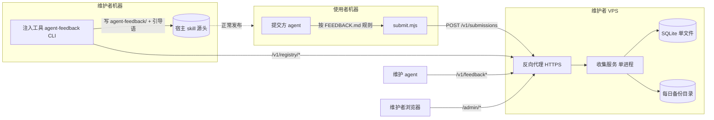
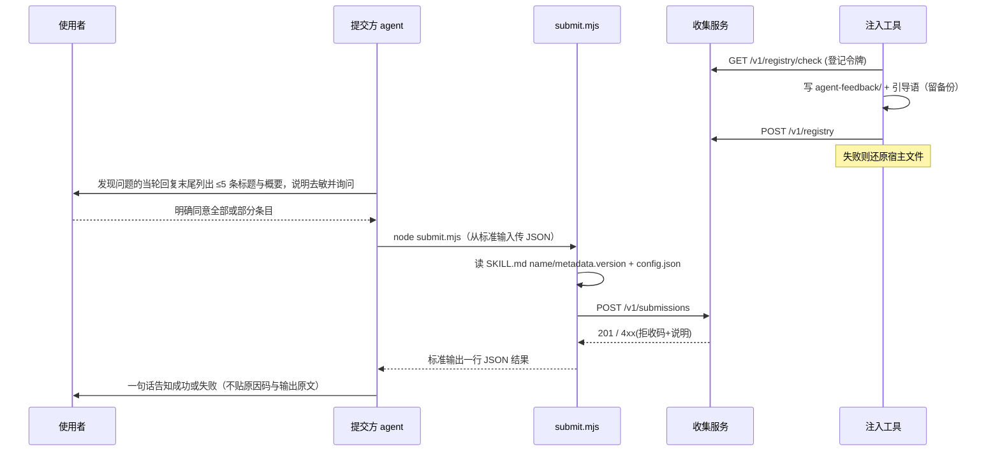

# Agent Feedback_00_Overview_顶层架构

> 本文按 RFC 2119 解释 MUST / MUST NOT / SHOULD / MAY。
> 需求真相源：`docs/REQUIREMENTS.md`。本文的设计输入为已归并归档的 `docs/spec/2026-09-29-agent-feedback-PRD.md`（下称 PRD）与 `docs/spec/2026-09-29-agent-feedback-prototype.html`（下称原型）。现行需求以 [需求真相源](../REQUIREMENTS.md) 与 `docs/requirements/` 为准，接口与实现验收以 [技术 spec](2026-09-29-agent-feedback-eng-spec.md) 为准；已归档 PRD 与原型仅作历史输入，不参与现行冲突裁决。本文只圈模块与契约，不展开实现。

## 0. 用户确认摘要（业务语言）

- 业务目标：让 agent 在使用维护者负责的 skill 遇到问题时，当轮列出问题、说明去敏并征得使用者明确同意后，把结构化反馈送到维护者的线上服务并告知结果；维护者在管理界面查看处理，维护 agent 通过查询通道按 skill 取反馈。
- 参与角色：使用者（装了宿主 skill，可同意全部或部分、拒绝反馈、全局关闭反馈）；提交方 agent（按反馈模块的规则判断、汇总、当轮询问、明确同意后立即提交与告知结果）；维护者（运行注入工具、登录管理界面）；维护 agent（凭查询令牌取清单、标状态）。
- 主流程： 维护者对 skill 源头运行注入工具（同时在线上服务登记）→ 按正常方式发布 → 使用者的 agent 遇到问题在发现问题的当轮回复末尾询问，使用者明确同意后在该轮立即提交并告知结果 → 1 分钟内可在界面与查询通道查到。
- 职责边界：线上服务是反馈数据与登记名单的唯一权威；反馈模块只负责"何时报、报什么、怎么发"；注入工具只负责"放模块、加引导语、登记"。宿主 skill 的原有说明与能力不变。
- 业务影响：宿主 skill 多一个子目录和一句引导语；宿主仓库流程要求的配套改动由维护者按仓库流程处理。无历史数据，无外部协作方。
- 主要风险与兜底：敏感信息误报 → 禁写清单 + 长度限制 + 可删除；刷量 → 网络地址 / 全站限额 + 登记名单；令牌泄露 → 令牌可撤销、令牌永不写进宿主；反馈里夹带诱导指令 → 查询结果标"不可信外部文本"。
- 明确不做：多作者平台、服务端自动处理反馈、通知推送、本地暂存重试、数据迁移、自动移除模块（详见 [需求真相源的非目标](../REQUIREMENTS.md#明确不做什么)）。
- 确认状态：已确认（2026-09-29，维护者）

## 1. 术语表

| 术语 | 含义 |
|---|---|
| 宿主 skill | 被注入反馈模块的、维护者负责的 skill 的源头目录 |
| 反馈模块 | 注入到宿主 skill 的 `agent-feedback/` 子目录：给 agent 的规则说明、公开说明、提交脚本、实例配置 |
| 提交脚本 | 反馈模块里的单文件 Node 脚本 `submit.mjs`，零第三方依赖 |
| 注入工具 | 维护者本机运行的 CLI `agent-feedback`，负责配置实例、注入、登记 |
| 收集服务 | 部署在维护者 VPS 上的单进程服务：公开提交入口、登记入口、查询通道、管理界面 |
| 实例 | 一个运行中的收集服务，以服务地址区分 |
| 登记令牌 / 查询令牌 | 两种由管理界面生成的 Bearer 令牌；前者只能登记，后者只能查询与标状态 |

## 2. 问题陈述

agent 使用 skill 遇到的问题只留在使用者本地会话里，维护者收不到。调研（2026-09-28）没有找到可复用的成熟方案，需要自建收集端与配套反馈模块（PRD §背景）。

## 3. 目标 / 非目标

- 目标：交付 [需求真相源](../REQUIREMENTS.md) 列出的反馈模块、注入工具、收集服务、管理界面与查询通道，以及维护 skill。
- 非目标：以 [需求真相源](../REQUIREMENTS.md#明确不做什么) 为准；另外不做：多实例同步、HTTP 以外的提交通道、管理界面多语言、移动端适配。

## 4. 系统边界（输入/输出）

- 流入收集服务：提交（公开，匿名）、登记与检查（登记令牌）、查询与标状态（查询令牌）、管理操作（登录会话）、健康检查（公开，外部探测用）。
- 流出：查询结果 JSON、管理界面 HTML、每日备份文件（服务器本地目录）。
- 流入宿主 skill：注入工具写入的 `agent-feedback/` 子目录与一句引导语。
- 反馈模块运行时读取：宿主 `SKILL.md` 的 frontmatter（`name`、`metadata.version`）与模块自带的 `config.json`（服务地址、模块版本）。

## 5. 架构分层

部署单元只有一个：收集服务进程（含管理界面服务端渲染）+ 一个 SQLite 文件，前面由维护者既有的反向代理终结 HTTPS。

## 5.5 既有系统清单（穷举不判断）

| 既有模块 / 机制 | 从哪知道它的 | 本次可能怎么碰到 | 卡片补了吗 |
|---|---|---|---|
| dw-system 安装器整目录覆盖安装副本 | `~/projects/dw-system/install.mjs:1030-1036`、`1645`、`1720-1721` | 注入对象若是安装副本会被抹掉 → 注入只认源头 | 本次新补 `engineering-context/dependencies/host-skills/分发与门禁.md` |
| dw-system 规范句单一归属闸 | `~/projects/dw-system/test/single-home.test.mjs:1-4` | FEEDBACK.md 含 MUST 句，同仓注入 ≥2 个 skill 会判红 | 同上 |
| dw-system 文档体积预算 | `~/projects/dw-system/test/doc-budgets.json` | 引导语使 dw-prd/SKILL.md 变大 | 同上 |
| zentao-skill 交付根白名单与名称锁定 | `~/projects/skills/zentao-skill/tests/test_交付根边界.py:15-33,55-63`、`tests/test_skill文档.py:42-44,77-80` | 新增 `agent-feedback/` 目录需登记白名单 | 同上 |
| 宿主 skill frontmatter：`name` 普遍存在，版本只有 `metadata.version` 一处被采用 | `~/projects/skills/agentic-principle/agentic-principle/SKILL.md:5`、`~/.claude/skills/skill-principle/references/principles.md:64,68` | 提交脚本运行期读取名称与版本 | 同上 |
| skill 编写规范：凭证不得硬编码、依赖装进 skill 自身目录 | `~/.claude/skills/skill-principle/references/principles.md:98-108,382-390` | 服务地址可写进模块、令牌不可；运行环境装进模块目录 | 同上 |
| 软链到源头的本机 skill（zentao-skill 等） | `~/.claude/skills` 目录列举 | 维护者自己使用时装出的运行环境会落进源头 → 模块自带忽略规则 | 同上 |

以上事实由 PRD 双轴复核子代理现读源码取得（PRD §现状与当前逻辑），本项目自身暂无既有代码。

## 6. Project Map（改造点清单）

本项目为单仓 npm workspaces。

| 仓库/模块 | 改造分类 | 改动范围 | owner |
|---|---|---|---|
| `packages/shared` | 🆕 新增 | 提交载荷的字段定义、长度与取值限制、校验函数、拒收码；三方共用，单一出处 | 维护者 |
| `packages/server` | 🆕 新增 | 收集服务：提交入口与把关、登记入口、查询通道、管理界面（服务端渲染）、令牌与会话、限额计数、到期清理、每日备份、健康检查、部署文件 | 维护者 |
| `packages/module` | 🆕 新增 | 反馈模块模板：`FEEDBACK.md`（agent 规则）、`PRIVACY.md`（公开说明）、`submit.mjs`（由 TS 打包成单文件）、`.gitignore` | 维护者 |
| `packages/injector` | 🆕 新增 | 注入工具 CLI：实例配置、前置检查、写模块、加引导语、登记、失败回滚 | 维护者 |
| 宿主 skill 源头 | 🔧 修改（由注入工具在运行时完成，不在本仓） | 新增 `agent-feedback/` 子目录与 `SKILL.md` 末尾一句引导语 | 维护者 |

> **不变的服务边界**：宿主 skill 原有说明与能力；维护者 VPS 上既有的反向代理与其他站点（本项目只提供一段代理配置示例）。

## 7. 模块边界表

| 模块 | Owns | 不 Owns | 上游入口 | 下游输出 |
|---|---|---|---|---|
| shared | 字段、限制、拒收码的唯一定义 | 网络、存储 | 被其余三个包 import | 无 |
| server | 反馈数据、登记名单与改名历史、令牌、限额计数、拒收计数、删除编号 | 宿主 skill 文件；使用者本机的任何东西 | HTTP | SQLite、备份文件、HTML、JSON |
| module | agent 的反馈规则；运行期读取宿主名称与版本；征得使用者明确同意后提交 | 提交是否被收录的判定；任何重试 | agent 调用 `node agent-feedback/submit.mjs` | POST /v1/submissions |
| injector | 维护者本机的实例配置（地址 + 登记令牌）；对宿主源头的文件改动；登记调用 | 反馈数据；查询 | 维护者命令行 | 宿主源头文件、/v1/registry/* |

## 8. 已定决策（locked-in）

| 决策名 | 方向 | 影响组件 |
|---|---|---|
| D1 语言与运行时 | 全部 TypeScript；服务端运行时 Node ≥ 22.13（内置 `node:sqlite`，无原生编译依赖，规避国内 VPS 拉取预编译二进制失败）；构建与测试 Node ≥ 22.18（内置类型剥离）；提交脚本运行在使用者机器上，只需 Node ≥ 20 | 全部 |
| D2 部署形态 | 单进程 + SQLite 单文件 + 反向代理终结 HTTPS + systemd 托管；境内 VPS、已备案域名 | server |
| D3 服务端框架 | 不引框架，用 `node:http` + 小型路由；管理界面服务端渲染 HTML 表单，无前端构建链 | server |
| D4 提交脚本 | 用 esbuild 打包成零依赖单文件 `submit.mjs`，只用 Node 内置模块 | module |
| D5 宿主身份来源 | 运行期读宿主 `SKILL.md` frontmatter 的 `name` 与 `metadata.version`，不写进 config.json；改名无需重新注入 | module |
| D6 模块位置与引导语 | 子目录固定 `agent-feedback/`；引导语追加在 `SKILL.md` 末尾，以 `<!-- agent-feedback -->` 标记行定位，保证幂等 | injector、module |
| D7 令牌 | 随机 32 字节，库中只存 SHA-256；Bearer 头传递；两种作用域分开 | server、injector |
| D8 管理员 | 单账号，部署时用服务自带命令设定用户名与密码（scrypt 哈希）；会话 cookie（HttpOnly、Secure、SameSite=Strict） | server |
| D9 日界线 | 所有日、月边界按北京时间（UTC+8，无夏令时，固定偏移计算） | server |
| D10 来源地址 | 反向代理后部署：只在配置 `TRUST_PROXY=1` 时取 `X-Forwarded-For` 最右一跳，否则取 socket 地址 | server |
| D11 定时任务 | 进程内定时器：每小时执行到期清理，每天北京时间 03:00 备份；过期备份在每小时维护中清理（口径见 spec §4.2） | server |
| D12 测试 | Node 内置 `node:test` + 类型剥离运行 TS；无额外测试框架 | 全部 |
| D13 关闭开关 | 环境变量 `AGENT_FEEDBACK_DISABLED=1`：提交脚本直接以 0 退出且不发请求；FEEDBACK.md 同时要求 agent 不起草 | module |
| D14 注入原子性 | 旧模块目录改名备份（并留存 SKILL.md 原文）→ 写宿主（新模块目录与引导语）→ 调登记；登记失败或写文件出错则回滚：删新模块目录、旧模块改名还原、SKILL.md 写回原文 | injector |

## 9. 通信契约

所有接口前缀 `/v1`，JSON，UTF-8。字段、限制、拒收码、响应结构与不可信标注 `notice` 的完整定义只在技术 spec 的 §2.1（提交载荷、拒收码）与 §3（接口契约），本文不复述：`docs/spec/2026-09-29-agent-feedback-eng-spec.md`。

| 接口 | 鉴权 | 用途 |
|---|---|---|
| `POST /v1/submissions` | 无 | 提交一次反馈（会话部分 + 1–5 条问题） |
| `GET /v1/registry/check?name=` | 登记令牌 | 注入前检查名称状态 |
| `POST /v1/registry` | 登记令牌 | 登记名称（已存在则不变） |
| `GET /v1/feedback?skill=…&…` | 查询令牌 | 按 skill 与字段筛选取清单 |
| `GET /v1/feedback/:id` | 查询令牌 | 取单条详情（含会话信息） |
| `PATCH /v1/feedback/:id` | 查询令牌 | 改处理状态 |
| `GET /healthz` | 无 | 外部可用性探测 |

## 10. 时序图

## 11. 失败 / 降级模型

| 失败点 | 表现 | 处理 |
|---|---|---|
| 服务不可达 / 超时（提交脚本 10 秒超时） | 提交脚本输出 `{ok:false, reason:"unreachable"}`，退出码 0 | agent 放弃、本会话不再提交；不暂存不重试 |
| 格式不合格 | 400 + 字段说明 | agent 修正后最多重试一次 |
| 限额 / 未登记 | 429 / 403 | agent 放弃 |
| 注入中途失败 | 注入工具非 0 退出并打印失败步骤 | 宿主文件还原到注入前 |
| 服务进程崩溃 | 健康检查失败 | systemd 自动重启；外部探测记可用率 |
| 数据损坏 / 服务器故障 | — | 从每日备份恢复，恢复后自动按删除编号重删并执行到期清理 |

## 12. 端到端不变量

1. 登记令牌、查询令牌、管理员密码 MUST NOT 出现在宿主 skill 的任何文件里。
2. 收集服务 MUST NOT 把反馈内容交给任何自动处理；查询结果 MUST 带不可信标注。
3. 未登记或停用 skill 的提交 MUST NOT 落库；被拒收的内容 MUST NOT 落库（只计数）。
4. 被删除的反馈编号 MUST NOT 在任何时候重新可查（含备份恢复后）。
5. 反馈模块在任何失败下 MUST 以退出码 0 结束，且 MUST NOT 向标准错误输出人类可读告警（避免 agent 转述）。

## 13. 子文档路线

| 子 spec | 覆盖 | 状态 |
|---|---|---|
| `docs/spec/2026-09-29-agent-feedback-eng-spec.md` | 四个包的数据模型、接口、核心逻辑、测试、部署；单仓，边界在同一份 spec 内分节（维护 skill 见 `2026-10-13-maintainer-skill-PRD.md`） | 已完成 |
| `docs/plan/2026-09-29-agent-feedback-coding-plan.md` | 按垂直切片拆任务，可并行派发 | 已完成 |

## 14. 定稿核查小表

**A. 既有系统对照**

| 既有系统/机制 | ①会经过/触发它？ | ②会被它挡在门外？ | ③需额外存/恢复数据？ | 结论 |
|---|---|---|---|---|
| dw-system 安装器覆盖 | 会（若注入安装副本） | 会：改动被抹掉 | 不会 | 已由"注入对象只认源头"覆盖；注入工具不做自动识别，由维护者指定路径 |
| 规范句单一归属闸 | 会 | 会：同仓第二个 skill 注入后测试变红 | 不会 | 属宿主仓库配套改动（见 [注入工具需求](../requirements/注入工具.md#失败与成功后的提示)），注入工具完成后打印提示 |
| 文档体积预算 | 会 | 可能 | 不会 | 同上 |
| zentao-skill 交付根白名单 | 会 | 会 | 不会 | 同上；提示中列出需登记的 `agent-feedback/` |
| frontmatter 名称与版本 | 会 | 未声明名称时挡住注入 | 不会 | 注入前检查 + 运行期读取（D5） |
| 凭证与依赖安装规范 | 会 | 不会 | 不会 | 不变量 1；运行环境装进 `agent-feedback/.runtime/` 且被模块 `.gitignore` 忽略 |
| 软链源头 | 会 | 不会 | 不会 | 模块自带 `.gitignore` 忽略 `.runtime/` |

**B. PRD 逐节覆盖矩阵**

| PRD 节 | ①覆盖 | ②隐患 | 处置 |
|---|---|---|---|
| 一句话结论 / 做完标志 | §0、§6 | 1 分钟可查：同步落库即可查 | 补正文（提交同步写库） |
| 目标 1–5 | §8 D11、§11 | 可用率靠外部探测 | 健康检查接口已列；外部探测不在本产品 |
| 非目标 1–9 | §3 | 镀金（通知、自动归并） | 已列非目标 |
| 改动范围 / 护栏 | §6 | 注入改动宿主其他文件 | D6 只追加末尾一句 + 子目录 |
| 注入工具规则（对象、实例配置、写入内容、改名未同步、旧名、换实例、原子性） | §8 D6/D14、§9 登记契约 | 改名未同步判定需知道模块记录的实例地址 | 注入工具读源头模块的 config.json 本地判定；详见 spec |
| 反馈模块行为规则 | §7、D13 | 规则是提示词，不可程序兜底 | 由 FEEDBACK.md 承载 + 上线评测 |
| 提交信息（会话/问题/服务端补充） | §9 | 字段在三处重复 | shared 包单一出处 |
| 把关规则（限额、名单、拒收记录、保留、备份） | §9、D9、D10、D11 | 计数与日界线 | spec 详述 |
| 管理界面（含改名、令牌、密码） | §6 server | 原型是临时视觉 | spec 按原型落结构 |
| 查询通道 | §9 | 注入诱导 | 不变量 2 |
| 特殊场景与冲突 | §11 | 同时改状态 | 最后写入为准 |
| AI 能力说明（准出评测） | 不在代码内 | 评测需要场景集 | coding plan 列一个任务产出 20+20 场景的评测清单模板，执行由维护者完成 |
| 运营度量 | 查询通道筛选 + 自定义起止 | — | 覆盖 |
| 风险与兜底 | §11 | 删除编号保留 | spec 数据模型含删除编号表（实现为库外只追加日志，见 spec §2.2） |

## 15. 开放问题

无。PRD 阶段的全部待拍板项已由维护者拍板（见 PRD changelog）；本文 §8 的技术决策属详细设计，由 AI 自主确定。

## 16. 引用

- PRD：`docs/spec/2026-09-29-agent-feedback-PRD.md`
- 原型：`docs/spec/2026-09-29-agent-feedback-prototype.html`（extract 与 annotations 已读，9 条 AI 说明、0 条用户批注）
- 既有系统事实：见 §5.5 各行 `文件:行`
